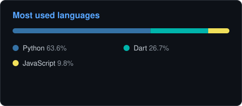
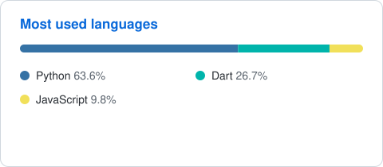
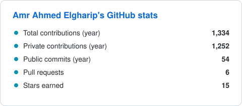

  

  

  
  
  
  
  

---

### 👋 About me

- 🏢 Founder & lead engineer at **[Todi Digital Services](https://todiai.com)**: I take products from the first line to launch and keep them running
- 🚀 Building **[Manasatna — منصتنا](https://manasatna.com)**, a white-label online academy for teachers in Egypt
- 🎓 Studying at the **College of Artificial Intelligence, Kafrelsheikh University**
- 🧠 Into computer vision: detection, classification and real-time video
- 📱 Shipping Flutter apps and React / Next.js front ends on NestJS and Laravel back ends
- 📫 Reach me at **amr@todiai.com**

 

---

### 🚀 Featured work

<table>
  <tr>
    <td width="50%" valign="top">
      <h4>🎓 <a href="https://manasatna.com">Manasatna — منصتنا</a></h4>
      Multi-tenant SaaS: every teacher or academy gets their own branded academy on their own domain, with protected video, auto-graded exams, attendance, WhatsApp updates for parents, an AI assistant and online payments.
        <b>NestJS · React · PostgreSQL · Prisma · Redis/BullMQ · DeepSeek</b>
    </td>
    <td width="50%" valign="top">
      <h4>🌿 <a href="https://github.com/amr-elgharip2006/Plant-Disease-Classification">GreenLens</a></h4>
      Identifies 38 plant diseases from a leaf photo with <b>99.39 % test accuracy</b>, and runs fully <a href="https://amr-elgharip2006.github.io/Plant-Disease-Classification/">in the browser</a>.
        <b>TensorFlow · EfficientNet · TF.js</b>
    </td>
  </tr>
  <tr>
    <td width="50%" valign="top">
      <h4>🚗 <a href="https://github.com/amr-elgharip2006/vehicle-traffic-density-estimator">Traffic Density Estimator</a></h4>
      Counts vehicles crossing a line in traffic video and estimates how congested the road is.
        <b>Python · YOLOv8 · OpenCV</b>
    </td>
    <td width="50%" valign="top">
      <h4>♻️ <a href="https://github.com/amr-elgharip2006/Deep_Waste_Classifier">Deep Waste Classifier</a></h4>
      Sorts waste photos into 7 recycling categories with transfer learning.
        <b>TensorFlow · Keras · EfficientNetB0</b>
    </td>
  </tr>
  <tr>
    <td width="50%" valign="top">
      <h4>🐍 Python for AI Platform: IEEE Kafrelsheikh SB</h4>
      Task submission platform for the student branch: students write and run Python in the browser and get checked on the spot.
        <b>Next.js · Prisma · Pyodide</b>
    </td>
    <td width="50%" valign="top">
      <h4>📊 <a href="https://github.com/amr-elgharip2006/Group1_DEPI">MTA Recovery Analytics</a></h4>
      New York subway and bus ridership recovery, 2019–2024: a DEPI team project.
        <b>Power BI · DAX</b>
    </td>
  </tr>
</table>

<b>📱 More projects: Flutter, PyTorch, OpenCV</b>

 

| Project | What it is |
|---|---|
| [flutter-shopping-app](https://github.com/amr-elgharip2006/flutter-shopping-app) | Shopping app with sign-up and routing, [live demo](https://amr-elgharip2006.github.io/flutter-shopping-app/) |
| [flutter-mini-product-catalog](https://github.com/amr-elgharip2006/flutter-mini-product-catalog) | Product catalog: state lifecycle and navigation |
| [flutter-movie-library](https://github.com/amr-elgharip2006/flutter-movie-library) | Movie library with list and grid views and search |
| [dl-pytorch-fundamentals-exercises](https://github.com/amr-elgharip2006/dl-pytorch-fundamentals-exercises) | All 10 PyTorch fundamentals exercises plus the challenge |
| [OpenCV series](https://github.com/amr-elgharip2006/cv-section1-opencv-fundamentals) | Image basics → transforms and HSV masks → section 3 ([1](https://github.com/amr-elgharip2006/cv-section1-opencv-fundamentals) · [2](https://github.com/amr-elgharip2006/cv-section2-opencv-tasks) · [3](https://github.com/amr-elgharip2006/cv-section3-opencv)) |

---

### 🛠️ Tech stack

  <b>Backend</b> 
    
  <b>Frontend & mobile</b> 
    
  <b>AI & data</b> 
    
  <b>Infra & hardware</b> 
  

---

### 📈 GitHub activity

  <picture>
    <source media="(prefers-color-scheme: dark)" srcset="https://raw.githubusercontent.com/amr-elgharip2006/amr-elgharip2006/output/stats-dark.svg">
    
  </picture>
  <picture>
    <source media="(prefers-color-scheme: dark)" srcset="https://streak-stats.demolab.com?user=amr-elgharip2006&theme=github-dark-blue&hide_border=true&border_radius=10">
    
  </picture>

  

  <picture>
    <source media="(prefers-color-scheme: dark)" srcset="https://raw.githubusercontent.com/amr-elgharip2006/amr-elgharip2006/output/snake-dark.svg">
    
  </picture>

---

### 📫 Find me

  
  
  
  
  
  

