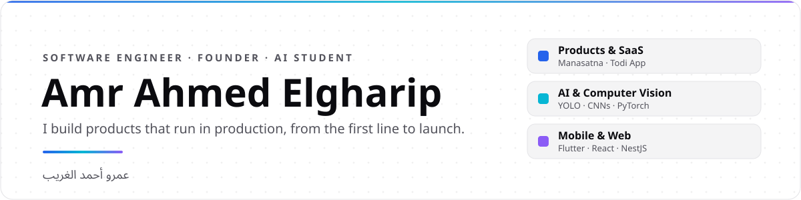
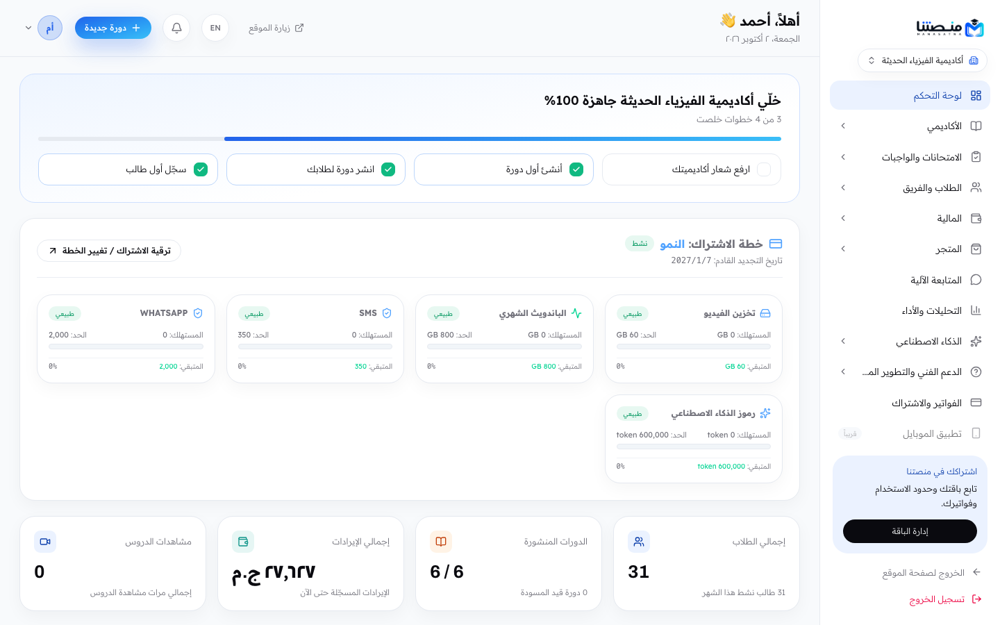

<picture>
  <source media="(prefers-color-scheme: dark)" srcset="assets/banner-dark.svg">
  
</picture>

  
  
  
  

## Hi, I'm Amr 👋

I founded **[Todi Digital Services](https://todiai.com)** to build software that actually runs in production, not prototypes. I take products from the first line to launch and beyond: architecture, databases, APIs, interfaces, servers and deployment, then I keep them running.

I'm also a student at the **College of Artificial Intelligence, Kafrelsheikh University**, so AI is never far from what I build.

## 🚀 What I'm building

### [Manasatna — منصتنا](https://manasatna.com) &nbsp;·&nbsp; flagship product

A multi-tenant SaaS that gives every teacher, tutoring center and academy in Egypt a complete online academy under their **own name, brand and domain**: courses with protected video, self-grading exams and assignments, attendance, WhatsApp updates for parents, an AI assistant for each academy's students, daily AI follow-up, and online payments, with every academy's data isolated from the others.

The teacher dashboard, a real screenshot from the demo academy.

**Built with** NestJS · React · PostgreSQL · Prisma · Redis + BullMQ · Bunny Stream · XPay · DeepSeek · Nginx 
**Links** [manasatna.com](https://manasatna.com) · [Teacher guide](https://docs.manasatna.com)

### Todi App

An AI assistant for managing commitments that understands Egyptian Arabic and Modern Standard Arabic, with an Arabic-first interface, built with Flutter and React.

## 🧪 AI & data projects

| Project | What it does | Built with |
|---|---|---|
| [**vehicle-traffic-density-estimator**](https://github.com/amr-elgharip2006/vehicle-traffic-density-estimator) | Counts vehicles crossing a line in traffic video and estimates traffic density | Python · YOLOv8 · OpenCV |
| [**Deep_Waste_Classifier**](https://github.com/amr-elgharip2006/Deep_Waste_Classifier) | Sorts waste photos into 7 categories using transfer learning on EfficientNetB0 | TensorFlow · Keras |
| [**Group1_DEPI**](https://github.com/amr-elgharip2006/Group1_DEPI) | New York MTA ridership and recovery analytics (2019–2024), a DEPI team project | Power BI |

## 🛠️ Tech I work with

| Area | Tools |
|---|---|
| **Backend** |      |
| **Frontend** |    |
| **Mobile** |   |
| **Data** |      |
| **AI / ML** |        |
| **Infra** |       |
| **Hardware** |    |

## 🤝 Find me

  
  
  
  
  
  
  

Made in Egypt 🇪🇬 · <a href="https://todiai.com">Todi Digital Services</a> — Build. Automate. Scale.

